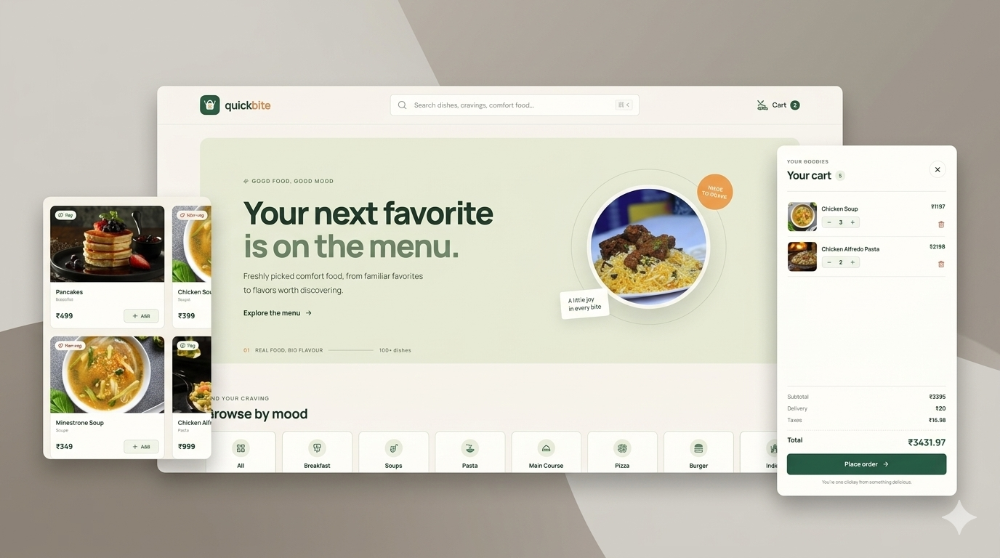

# QuickBite — Food Order App (React)

A modern, responsive **food ordering web app** built with **React** and **Vite**.  
Browse dishes by category, search the menu, manage a shopping cart, and place an order — all with a clean, polished UI.

**Live demo:** [food-order-app-react-wheat.vercel.app](https://food-order-app-react-wheat.vercel.app/)



---

## Features

- **Hero & menu** — Eye-catching landing section and a grid of dishes with images, prices, and veg/non-veg tags
- **Category filters** — Browse by All, Breakfast, Soups, Pasta, Main Course, Pizza, Burger, Indian
- **Live search** — Filter dishes by name from the sticky top bar
- **Shopping cart** — Add items, adjust quantities, remove products; cart opens as a slide-out drawer
- **Order summary** — Subtotal, fixed delivery fee, taxes, and total
- **Place order** — Confirmation modal that clears the cart after a short delay
- **Responsive design** — Works on desktop, tablet, and mobile
- **Accessibility** — ARIA labels, keyboard-friendly controls, and clear focus states

---

## Tech Stack

| Layer        | Tools                                      |
|--------------|--------------------------------------------|
| UI           | React 19                                   |
| Build        | Vite 8                                     |
| State        | Redux Toolkit (cart) + React Context (UI)  |
| Icons        | react-icons                                |
| Styling      | Custom CSS                                 |
| Linting      | Oxlint                                     |

---

## Getting Started

### Prerequisites

- **Node.js** 18+ (recommended)
- **npm** (or yarn / pnpm)

### Install & run

```bash
# clone the repo
git clone https://github.com/Souravbanerjeedata/food-order-app-react.git
cd food-order-app-react

# install dependencies
npm install

# start development server
npm run dev
```

Open the URL shown in the terminal (usually `http://localhost:5173`).

### Other scripts

```bash
npm run build    # production build
npm run preview  # preview production build
npm run lint     # run Oxlint
```

---

## Project Structure

```
food-order-app-react/
├── public/
├── src/
│   ├── assets/           # Food images & brand mark
│   ├── components/       # Nav, Card, CartCard
│   ├── context/          # UserContext (search, cart visibility, modal)
│   ├── pages/            # Home
│   ├── redux/            # cartSlice + store
│   ├── Category.jsx      # Category list
│   ├── food.js           # Menu data
│   ├── foodExtras.js     # Extra menu items
│   ├── App.jsx
│   ├── main.jsx
│   └── index.css
├── index.html
├── package.json
└── vite.config.js
```

---

## How it works

1. **Menu data** lives in `src/food.js` (and `foodExtras.js`) with name, category, type (veg/non-veg), image, and price.
2. **Context** (`UserContext`) holds search input, filtered list, cart drawer open state, and order-success modal.
3. **Redux** manages the cart: add, remove, increase/decrease quantity, and clear after placing an order.
4. **Home** page ties everything together: hero, categories, searchable grid, cart drawer, and success modal.

---

## Author

**Sourav Banerjee**  
- GitHub: [Souravbanerjeedata](https://github.com/Souravbanerjeedata)  
- X: [@souravdotcode](https://x.com/souravdotcode)

---

## License

This project is available for personal and learning use. Feel free to fork and adapt it.
